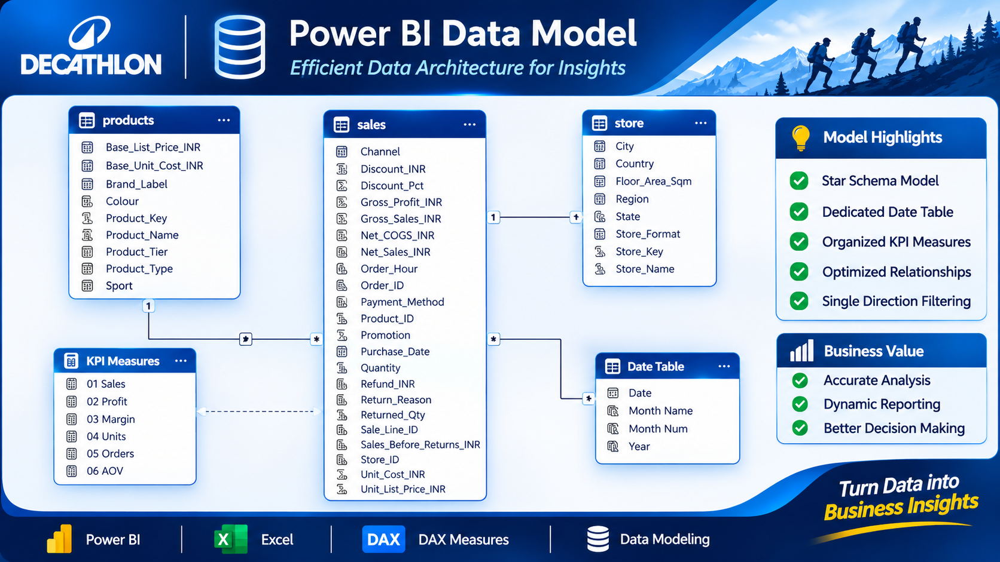

<div align="center">

# DECATHLON RETAIL ANALYTICS

### Retail Sales & Profitability Dashboard

<p>


</p>

**Transforming Retail Data into Actionable Business Insights**

</div>

---

## 📌 Project Overview

This project presents an interactive Decathlon Retail Sales & Profitability Dashboard developed using Microsoft Power BI.

The solution analyzes retail business performance across sales, profitability, product categories, sports, brands, and geographical regions.

It transforms raw Excel datasets into meaningful business insights using Power Query, relational data modeling, DAX measures, and interactive visualizations.

## 🎯 Business Objectives

- Analyze overall retail sales and profitability.
- Monitor current-year vs previous-year performance.
- Identify top-performing sports categories and brands.
- Evaluate product-level sales and gross margins.
- Analyze regional sales contributions.
- Track key business performance indicators.

## 🛠️ Technology Stack

<div align="center">


</div>

| Technology | Application |
|---|---|
| Microsoft Excel | Dataset Management |
| Power Query | Data Transformation |
| Power BI | Dashboard Development |
| DAX | KPI Calculations |
| Data Modeling | Relationship Management |
| Data Visualization | Business Reporting |

## 📂 Dataset Description

Three Excel datasets are used in this project.

| Dataset | Description |
|---|---|
| Products | Product, brand, sport, category and pricing information |
| Sales | Sales transactions, discounts, profit, quantity and returns |
| Store | Store details, geographical location and regional information |

---

## 📊 Dashboard Preview

<div align="center">

### RETAIL PERFORMANCE – SALES & PROFITABILITY OVERVIEW


</div>

## 📈 Key Performance Indicators

| KPI | Current Year | Previous Year |
|---|---:|---:|
| Net Sales YTD | ₹55.26M | ₹44.40M |
| Net Gross Profit YTD | ₹21.72M | ₹17.33M |
| Gross Margin YTD | 39.3% | 39.0% |
| Net Units Sold YTD | 46.19K | 38K |
| Net Orders YTD | 24.08K | 19.577K |
| Net AOV YTD | ₹2.82K | ₹2.27K |

*YTD comparison through 15 September against the same period in 2025.*

## 📊 Dashboard Features

**01. Monthly Net Sales**
- Current Year vs Previous Year sales trends.
- Monthly performance comparison.

**02. Top 5 Net Sales by Sport**
- Hiking, Badminton, Fitness, Cricket and Cycling.
- Sports category performance.

**03. Product Type Performance**
- Net sales analysis.
- Gross margin comparison.

**04. Regional Sales Performance**
- Regional sales contribution.
- Geographical performance analysis.

**05. Top 5 Net Sales by Brand**
- Brand-wise sales comparison.
- Top-performing brands.

**06. Interactive Filters**
- State
- Sport
- Product Tier
- Store Name
- Payment Method

---

## 🏗️ Data Model Architecture

The Power BI data model connects the Sales fact table with Products, Store, and Date dimensions.

A dedicated KPI Measures table organizes DAX calculations into six logical groups.

<div align="center">

### POWER BI DATA MODEL



</div>

### Model Components

| Component | Purpose |
|---|---|
| Sales | Central transaction table |
| Products | Product dimension |
| Store | Store dimension |
| Date Table | Time intelligence analysis |
| KPI Measures | Centralized DAX calculations |

**Model Highlights:**
- One-to-many relationships.
- Dedicated Date Table.
- Organized KPI Measures.
- Single-direction filtering.
- Time intelligence support.

---

## 🧮 DAX Measures & Organization

DAX measures are organized into six folders under the dedicated KPI Measures table.

| Folder | Measure Categories |
|---|---|
| 01 Sales | Net Sales, CY Sales, PY Sales, YTD, PYTD, YoY Growth |
| 02 Profit | Gross Profit, YTD, PYTD, YoY Growth |
| 03 Margin | Gross Margin, YTD, PYTD, YoY Comparison |
| 04 Units | Net Units Sold, YTD, PYTD, YoY Growth |
| 05 Orders | Net Orders, YTD, PYTD, YoY Growth |
| 06 AOV | Net AOV, YTD, PYTD, YoY Growth |

### Key DAX Concepts

- Year-to-Date (YTD)
- Previous Year-to-Date (PYTD)
- Year-over-Year (YoY)
- Sales Growth %
- Gross Margin %
- Average Order Value
- Dynamic KPI Display Measures

## 💡 Key Business Insights

- Net Sales reached ₹55.26M, representing 24.3% YoY growth.
- Gross Profit increased by 25.3%.
- Gross Margin reached 39.3%.
- Hiking recorded the highest sales among sports categories.
- Quechua was the leading brand by net sales.
- South region contributed 31.69% of total net sales.

## ⚙️ Project Workflow

<div align="center">

**Excel Datasets**

⬇️

**Power Query – Data Preparation**

⬇️

**Data Modeling – Relationships & Date Table**

⬇️

**DAX – KPI & Time Intelligence Measures**

⬇️

**Power BI – Interactive Dashboard**

⬇️

**Business Insights & Reporting**

</div>

## 📁 Repository Structure

```text
Decathlon-Retail-Analytics/
│
├── Dataset/
│   ├── products.xlsx
│   ├── sales.xlsx
│   └── store.xlsx
│
├── PowerBI/
│   └── Decathlon_Dashboard.pbix
│
├── Screenshots/
│   ├── Decathlon_Dashboard.png
│   └── Data_Model.png
│
└── README.md
```

## 🚀 Project Outcome

Developed an interactive retail business intelligence solution that converts raw sales data into meaningful business insights.

This project demonstrates practical experience in Power BI dashboard development, data transformation, relational data modeling, DAX calculations, KPI reporting, and retail performance analysis.

---

<div align="center">

## 👨‍💻 DEVELOPED BY

# Anthony Raj

**Aspiring Data Analyst | Power BI | SQL | Excel | Python**

<a href="https://www.linkedin.com/in/anthony-raj/">

</a>

<a href="https://github.com/anthony-raj-analytics">

</a>

</div>
