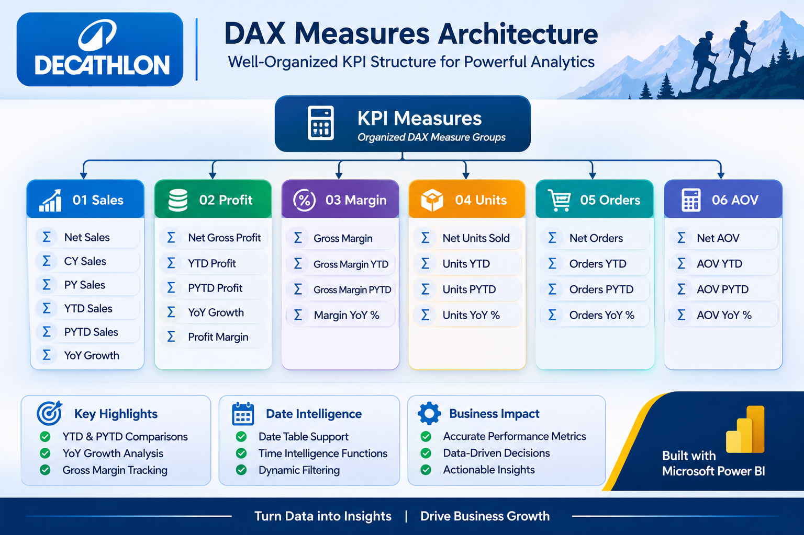

<div align="center">

# DECATHLON RETAIL ANALYTICS

### Retail Sales & Profitability Intelligence

<p align="center">
  
  
  
  
</p>

**Transforming Retail Data into Actionable Business Insights**

<br>

<a href="#dashboard">Dashboard</a> &nbsp; • &nbsp;
<a href="#datamodel">Data Model</a> &nbsp; • &nbsp;
<a href="#dax">DAX Architecture</a> &nbsp; • &nbsp;
<a href="#insights">Insights</a> &nbsp; • &nbsp;
<a href="#technologies">Technologies</a>

</div>

---

## 📌 Project Overview

This project presents an interactive **Decathlon Retail Sales & Profitability Dashboard** developed using Microsoft Power BI.

The solution analyzes retail sales, profitability, product performance, sports categories, brands, and regional contributions.

Raw Excel datasets are transformed into meaningful business insights using Power Query, relational data modeling, DAX calculations, and interactive visualizations.

## 🎯 Business Objectives

- Analyze retail sales and profitability.
- Compare current-year and previous-year performance.
- Monitor monthly sales trends.
- Identify top-performing sports and brands.
- Evaluate product-level performance.
- Analyze regional sales contributions.
- Track key business KPIs.

---

<a id="dashboard"></a>

## 📊 01. Power BI Dashboard

<div align="center">

### RETAIL PERFORMANCE
**Sales & Profitability Overview**


</div>

### Key Performance Indicators

| KPI | Current Year | Previous Year |
|---|---:|---:|
| Net Sales YTD | ₹55.26M | ₹44.40M |
| Net Gross Profit YTD | ₹21.72M | ₹17.33M |
| Gross Margin YTD | 39.3% | 39.0% |
| Net Units Sold YTD | 46.19K | 38K |
| Net Orders YTD | 24.08K | 19.577K |
| Net AOV YTD | ₹2.82K | ₹2.27K |

### Dashboard Visualizations

| Visualization | Analysis |
|---|---|
| Monthly Net Sales | Current vs Previous Year |
| Top 5 Sports | Sports Category Performance |
| Product Type Performance | Sales & Gross Margin |
| Regional Sales | Geographical Contribution |
| Top 5 Brands | Brand Performance |
| Interactive Filters | Dynamic Analysis |

### Interactive Filters

`State` · `Sport` · `Product Tier` · `Store Name` · `Payment Method`

---

<a id="datamodel"></a>

## 🏗️ 02. Data Model Architecture

<div align="center">

### POWER BI RELATIONAL DATA MODEL


</div>

### Model Components

| Table | Purpose |
|---|---|
| Sales | Central transaction fact table |
| Products | Product attributes and pricing |
| Store | Store and geographical information |
| Date Table | Time intelligence |
| KPI Measures | Centralized DAX calculations |

### Data Modeling Highlights

- One-to-many relationships.
- Dedicated Date Table.
- Central Sales fact table.
- Product and Store dimensions.
- Single-direction filtering.
- Organized KPI Measures.

---

<a id="dax"></a>

## 🧮 03. DAX Measures Architecture

<div align="center">

### ORGANIZED DAX MEASURE STRUCTURE



</div>

DAX calculations are organized into six logical folders inside the dedicated KPI Measures table.

| Folder | Measure Categories |
|---|---|
| 01 Sales | Net Sales, CY Sales, PY Sales, YTD, PYTD, YoY Growth |
| 02 Profit | Net Gross Profit, YTD, PYTD, YoY Growth |
| 03 Margin | Gross Margin, YTD, PYTD, YoY Comparison |
| 04 Units | Net Units Sold, YTD, PYTD, YoY Growth |
| 05 Orders | Net Orders, YTD, PYTD, YoY Growth |
| 06 AOV | Net AOV, YTD, PYTD, YoY Growth |

### Key DAX Concepts

- Year-to-Date (YTD)
- Previous Year-to-Date (PYTD)
- Year-over-Year (YoY)
- Sales Growth %
- Gross Margin %
- Average Order Value
- Dynamic KPI Display Measures

---

<a id="insights"></a>

## 💡 04. Business Insights

| Business Area | Key Finding |
|---|---|
| Sales | ₹55.26M Net Sales |
| Profit | ₹21.72M Gross Profit |
| Margin | 39.3% Gross Margin |
| Sports | Hiking recorded highest sales |
| Brand | Quechua recorded highest sales |
| Region | South contributed 31.69% |

### Business Value

- Improved retail performance visibility.
- Better sales and profitability monitoring.
- Product and brand performance evaluation.
- Regional performance comparison.
- Data-driven decision support.

---

## ⚙️ 05. Project Workflow

<div align="center">

| Stage | Process |
|:---:|---|
| 01 | 📁 Excel Datasets |
| ↓ | |
| 02 | 🔄 Power Query – Data Transformation |
| ↓ | |
| 03 | 🗂️ Data Modeling – Relationships & Date Table |
| ↓ | |
| 04 | 🧮 DAX – KPI & Time Intelligence |
| ↓ | |
| 05 | 📊 Power BI – Dashboard Development |
| ↓ | |
| 06 | 💡 Business Insights & Reporting |

</div>

---

<a id="technologies"></a>

## 🛠️ 06. Technologies & Tools

<div align="center">

<table>
<tr>
<td align="center" width="25%">

<br><b>Power BI</b>
<br><sub>Dashboard Development</sub>
</td>
<td align="center" width="25%">

<br><b>Excel</b>
<br><sub>Dataset Management</sub>
</td>
<td align="center" width="25%">

<br><b>Power Query</b>
<br><sub>Data Transformation</sub>
</td>
<td align="center" width="25%">

<br><b>DAX</b>
<br><sub>KPI Calculations</sub>
</td>
</tr>
</table>

</div>

---

## 📂 07. Repository Structure

```text
Decathlon-Retail-Analytics/
│
├── Dataset/
│   ├── products.xlsx
│   ├── sales.xlsx
│   └── store.xlsx
│
├── PowerBI/
│   └── Decathlon_Dashboard.pbix
│
├── Screenshots/
│   ├── Dashboard.png
│   ├── Data_Model.png
│   ├── DAX_Measures.png
│   └── README.md
│
└── README.md
```

## 🚀 08. Project Outcome

Developed an interactive retail business intelligence solution that transforms raw sales data into meaningful business insights.

**Skills Demonstrated:**

- Data Preparation & Transformation
- Relational Data Modeling
- DAX Calculations & Time Intelligence
- KPI Development
- Interactive Dashboard Design
- Retail Sales & Profitability Analysis

---

<div align="center">

<a id="author"></a>

## 👨‍💻 ABOUT THE DEVELOPER

# Anthony Raj

**Aspiring Data Analyst**

<p>


</p>

<a href="https://www.linkedin.com/in/anthony-raj/">

</a>

<a href="https://github.com/anthony-raj-analytics">

</a>

<br><br>

**THANK YOU FOR VISITING MY PROJECT**

*Turning Data into Insights.*

</div>
